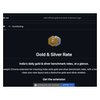

# Gold & Silver Rate — Chrome Extension

Gold & Silver Rate is a Chrome extension for checking India-wide daily benchmark values for gold and silver.

## Brand assets
- The README uses a 128px transparent logo export so GitHub does not enlarge a 32px thumbnail and blur the artwork.
- The supplied gold-and-silver emblem is used for the Chrome and Edge extension icons.
- The original transparent PNG is retained as `assets/logo-128.png` and referenced by all manifest icon sizes.

## Features
- Bottom price-mode controls and source note have a dedicated, evenly spaced footer row. The popup is constrained to one view with no internal scrolling.
- Gold: 24K, 22K and 18K, displayed per 10 grams.
- Silver: 1kg, 10g and 1g reference values.
- India-wide benchmark rates; no location picker.
- Historical price chart above the rate cards, with Week, Month and Year filters. Week and Month are derived from the available 30-day source window; Year displays only the source's available coverage.
- Popup uses a more spacious single-view layout with clearer separation between the header, tabs, chart and rate cards. The popup remains constrained to one view without internal scrolling.
- Historical chart uses published daily observations only; carried-forward and missing rows are not plotted.
- Chart values follow the selected GST display mode and use per-10g units.
- Manual refresh from the popup.
- Last-successful response cached locally.
- Optional estimated 3% GST-inclusive display.
- Remembers the last selected metal tab.

## Install
1. Download and extract the repository ZIP or packaged build.
2. Open `chrome://extensions` in Chrome.
3. Enable Developer mode.
4. Click **Load unpacked**.
5. Select this folder, the one containing `manifest.json`.

## Data feeds
- Gold: https://snapdata.dev/api/v1/gold/in/latest.json
- Silver: https://snapdata.dev/api/v1/silver/in/latest.json

The feeds are daily benchmark snapshots, not live intraday quotes or city-specific retail prices.

## Price calculations
- Gold per 10g = per-gram observation × 10.
- Silver per gram = per-kilogram observation ÷ 1,000.
- Silver per 10g = per-gram value × 10.
- The optional GST-inclusive view multiplies the metal value by 1.03. Making charges and other invoice components are excluded.

## Permissions
- `storage`: settings, selected tab and cached rate response.
- `alarms`: daily background refresh attempt.
- Host access to `https://snapdata.dev/*`: fetch published rate feeds.

## Attribution
The feed is published through Snapdata and identifies IBJA benchmark observations. Review the provider's current [documentation and terms](https://snapdata.dev/docs/).

For installation, privacy, troubleshooting and full project details, see the [repository README](../README.md).
